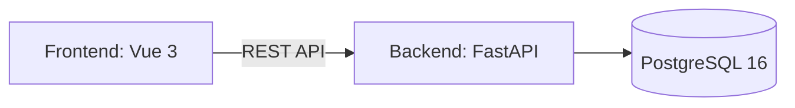
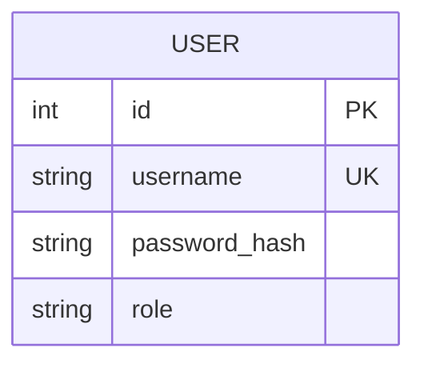

# Паспорт архитектуры и стека

**Проект:** СпортКаталог

## 1. Схема системы



Сайт отправляет запросы на сервер FastAPI.
Сервер обрабатывает регистрацию и вход, взаимодействует с PostgreSQL.
Пользователи сохраняются в базе данных.

## 2. Стек

| Слой | Технология |
|---|---|
| Фронтенд | Vue 3, TypeScript, Vite |
| Бэкенд | Python, FastAPI, Pydantic |
| База данных | PostgreSQL 16 |
| Работа с БД | SQLAlchemy 2.0 (async), asyncpg |
| Авторизация | JWT, PyJWT |
| Хеширование паролей | Argon2, pwdlib |
| Запуск | Docker Compose |
| Веб-сервер фронтенда | Nginx |

На следующем этапе планируется добавить
Vue Router, Pinia, Axios, Alembic и Chart.js.
На текущем этапе фронтенд использует Axios для запросов.

## 3. Фронтенд архитектура

```text
frontend/
├── src/
│   ├── main.ts
│   └── App.vue
├── index.html
├── package.json
├── vite.config.ts
├── nginx.conf
└── Dockerfile
```

App.vue содержит формы регистрации, входа
и страницу авторизованного пользователя.

## 4. Бэкенд архитектура

```text
backend/
├── app/
│   ├── __init__.py
│   └── main.py
├── requirements.txt
└── Dockerfile
```

На первом этапе main.py содержит маршруты регистрации,
входа и получения текущего пользователя.

API:
- POST /api/auth/register — регистрация;
- POST /api/auth/login — вход;
- GET /api/auth/me — получение текущего пользователя;
- GET /api/health — проверка сервера и соединения с БД.

По мере реализации следующих FR логика будет разделена
на отдельные модули API, models, schemas и services.

## 5. Модель данных



На первом этапе реализована таблица USER.

В следующих этапах по принятому паспорту проекта
будут добавлены PRODUCT, ORDER, ORDER_ITEM
и STOCK_RECEIPT.

Регистрация создаёт пользователя с ролью buyer.
Роль администратора будет реализована отдельно.

## 6. Запуск

Все три сервиса описаны в compose.yaml.
Проект запускается командой:

`docker compose up -d`

Фронтенд доступен по адресу http://localhost:8080.
API-документация: http://localhost:8080/api/docs.
