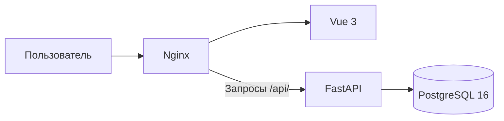
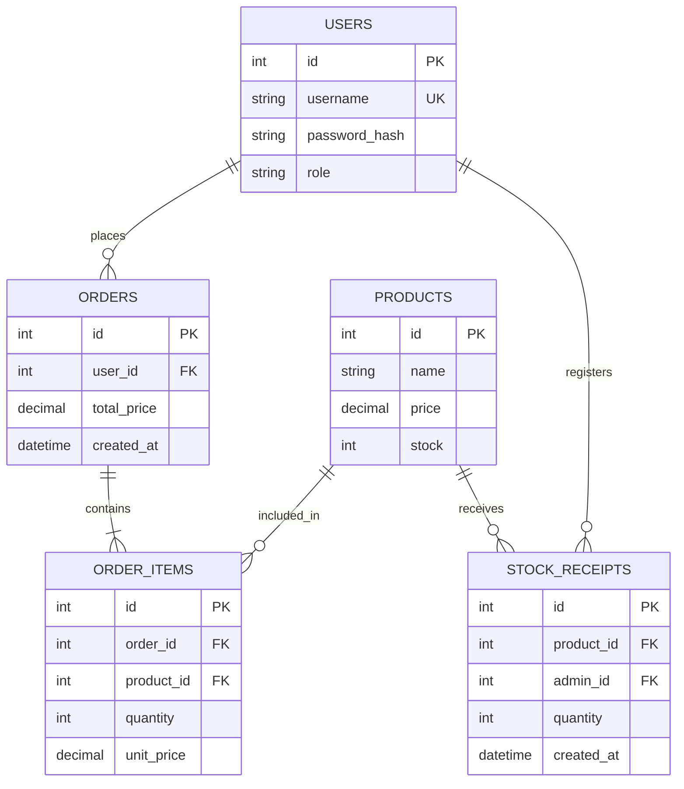

# Паспорт архитектуры и стека

**Проект:** СпортКаталог

**Стек:** Vue 3 + TypeScript + FastAPI + PostgreSQL

## 1. Схема системы



Система представляет собой веб-приложение, состоящее из фронтенда, бэкенда и базы данных.

Фронтенд на Vue 3 отвечает за интерфейс сайта. Через него пользователь может зарегистрироваться, войти в личный кабинет и в дальнейшем работать с каталогом спортивных товаров.

Бэкенд на FastAPI обрабатывает запросы пользователей, проверяет введённые данные и взаимодействует с базой PostgreSQL.

Nginx используется для передачи файлов фронтенда в браузер и перенаправления API-запросов на FastAPI.

Все три компонента запускаются через Docker Compose. Для PostgreSQL предусмотрено отдельное хранилище данных.

## 2. Стек

| Слой | Технология | Назначение |
|---|---|---|
| Фронтенд | Vue 3 | Интерфейс сайта |
| Язык фронтенда | TypeScript | Разработка фронтенда |
| Сборка | Vite | Сборка Vue-приложения |
| HTTP-клиент | Axios | Отправка запросов на сервер |
| Веб-сервер | Nginx | Обслуживание фронтенда и передача API-запросов |
| Бэкенд | Python, FastAPI | Обработка запросов |
| Проверка данных | Pydantic v2 | Проверка введённого логина и пароля |
| Работа с БД | SQLAlchemy 2.0 (async) | Обращение к PostgreSQL |
| Драйвер БД | asyncpg | Асинхронное подключение |
| База данных | PostgreSQL 16 | Хранение пользователей и других данных |
| Авторизация | JWT, PyJWT | Выдача и проверка токенов |
| Хеширование паролей | pwdlib, Argon2 | Хранение паролей в виде хешей |
| Контейнеризация | Docker Compose | Запуск компонентов одной командой |

На следующих этапах для перехода между страницами планируется добавить Vue Router, для управления состоянием приложения — Pinia, для изменения структуры базы данных — Alembic, а для построения графиков покупок — Chart.js.

## 3. Фронтенд архитектура

Текущая структура фронтенда:

```text
frontend/
├── src/
│   ├── App.vue
│   └── main.ts
├── index.html
├── package.json
├── vite.config.ts
├── tsconfig.json
├── nginx.conf
└── Dockerfile
```

**Назначение основных файлов:**

- `App.vue` — формы регистрации и авторизации, личный кабинет и обработка запросов к серверу.
- `main.ts` — запуск Vue-приложения.
- `index.html` — основная HTML-страница.
- `package.json` — список библиотек и команд сборки.
- `vite.config.ts` — настройки Vite.
- `tsconfig.json` — настройки TypeScript.
- `nginx.conf` — настройки веб-сервера Nginx.
- `Dockerfile` — сборка фронтенда и его запуск через Nginx.

Сейчас интерфейс состоит из одной страницы, которая меняет содержимое в зависимости от состояния авторизации.

После реализации каталога фронтенд будет разделён на несколько страниц:

| Страница | Назначение |
|---|---|
| Каталог | Просмотр спортивных товаров, цен и остатков |
| Регистрация и вход | Создание аккаунта и авторизация |
| Мои заказы | История заказов покупателя |
| Статистика | График покупок и его скачивание |
| Управление товарами | Добавление товаров и учёт поступлений администратором |

## 4. Бэкенд архитектура

Текущая структура бэкенда:

```text
backend/
├── app/
│   ├── __init__.py
│   └── main.py
├── requirements.txt
└── Dockerfile
```

**Назначение файлов:**

- `main.py` — создание FastAPI-приложения, подключение к БД, модель пользователя, регистрация и авторизация.
- `__init__.py` — файл Python-пакета.
- `requirements.txt` — список Python-библиотек.
- `Dockerfile` — создание контейнера и запуск сервера Uvicorn.

На текущем этапе вся логика бэкенда находится в `main.py`, поскольку реализованы только регистрация, вход и получение данных пользователя.

### Реализованные API

| Метод | Адрес | Назначение |
|---|---|---|
| POST | `/api/auth/register` | Регистрация |
| POST | `/api/auth/login` | Авторизация |
| GET | `/api/auth/me` | Данные текущего пользователя |
| GET | `/api/health` | Проверка работы сервера и подключения к БД |

При регистрации пользователь указывает логин и пароль. Pydantic проверяет формат данных, после чего пароль хешируется и пользователь сохраняется в PostgreSQL.

При входе FastAPI находит пользователя по логину и проверяет пароль. Если данные верны, сервер создаёт JWT-токен со сроком действия один час.

Фронтенд сохраняет токен в `sessionStorage` и передаёт его при обращении к защищённому API. Сервер проверяет токен и возвращает данные пользователя.

### Планируемые функции

После реализации каталога и заказов в бэкенде появятся отдельные модули для работы с товарами, заказами, складом и статистикой.

Для администратора будет предусмотрено добавление товаров и регистрация их поступления. Обычный покупатель не сможет вызывать административные методы API.

При покупке сервер будет проверять количество товара и уменьшать остаток после успешного создания заказа.

Для исключения продажи последнего товара двум покупателям одновременно планируется использовать транзакции PostgreSQL с блокировкой записи товара (`SELECT FOR UPDATE`). Если товара недостаточно, сервер отклонит заказ с ошибкой HTTP 409.

Историю заказов покупатель сможет скачивать в CSV. Для построения графика сервер будет возвращать данные о количестве заказанных товаров, а фронтенд отображать их через Chart.js.

## 5. Модель данных

### Текущая модель

На первом этапе используется таблица `users`.


| Поле | Назначение |
|---|---|
| `id` | Уникальный идентификатор |
| `username` | Логин пользователя |
| `password_hash` | Хеш пароля |
| `role` | Роль пользователя |

Поле `username` должно быть уникальным. При обычной регистрации пользователь получает роль `buyer`. Использование роли администратора будет добавлено на следующем этапе.

### Планируемая модель

Для реализации оставшихся функциональных требований предусмотрены следующие таблицы:



**Описание таблиц:**

| Таблица | Назначение |
|---|---|
| `users` | Пользователи и их роли |
| `products` | Товары, цены и складские остатки |
| `orders` | Заказы покупателей |
| `order_items` | Товары и их количество в каждом заказе |
| `stock_receipts` | История поступлений товара |

Таблица `orders` связана с пользователем, а `order_items` содержит состав заказа. Это позволит одному заказу включать несколько товаров.

Таблица `stock_receipts` предназначена для записи поступлений на склад. При регистрации поступления количество товара в `products` будет увеличиваться.

Для количества товара предусмотрено ограничение на неотрицательный остаток. При покупке создание заказа и изменение остатка должны выполняться в одной транзакции.

## 6. Запуск проекта

В корне проекта расположен файл `compose.yaml`, который описывает три сервиса:

- `frontend` — Vue-приложение, обслуживаемое Nginx;
- `backend` — сервер FastAPI;
- `db` — PostgreSQL.

В файле `.env` задаются пароль PostgreSQL и секретный ключ JWT. Он не включается в публичный репозиторий.

Запуск выполняется командой:

```bash
docker compose up -d --build
```

После запуска сайт доступен через порт 8080.

Для локального запуска используется `http://localhost:8080`. При работе через GitHub Codespaces сайт открывается по адресу перенаправленного порта.

Документация FastAPI доступна по пути `/api/docs`.

## 7. Текущее состояние разработки

| Требования | Состояние |
|---|---|
| FR-0 — Docker Compose | Реализовано |
| FR-1 — регистрация и авторизация | Основной сценарий реализован |
| FR-2–FR-7 — заказы, каталог, статистика | Планируется |
| FR-8 — роли покупателя и администратора | Поле роли добавлено, разграничение прав планируется |
| FR-9–FR-11 — поступления, остатки, одновременные покупки | Планируется |

Текущая версия позволяет зарегистрировать пользователя, войти по логину и паролю и получить данные личного кабинета.

Дальнейшая разработка будет проводиться в соответствии с функциональными требованиями принятого паспорта проекта.